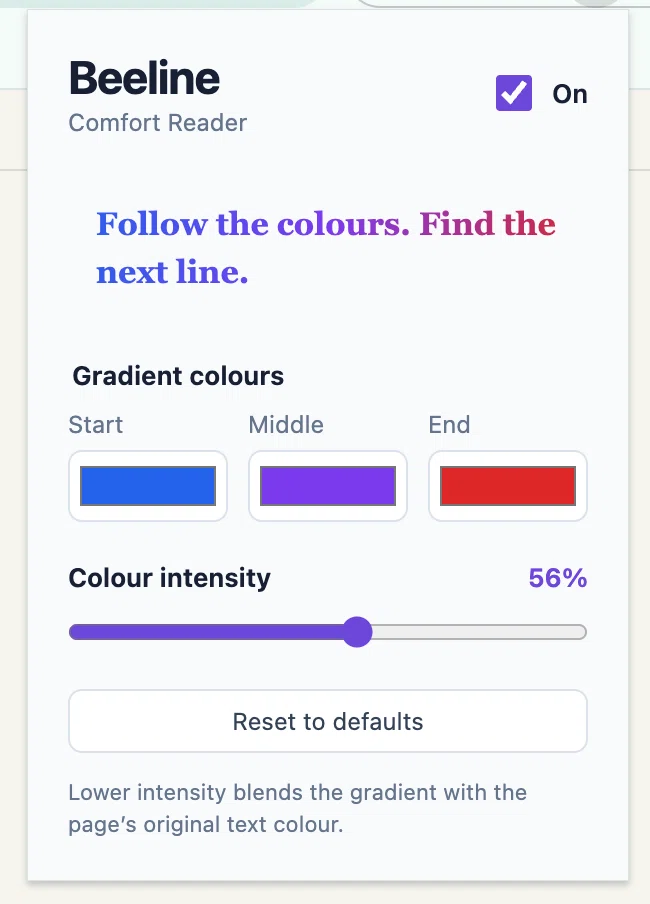

# Beeliner

**Give your eyes a little guidance, and enjoy the read.**

Beeliner is a small, open-source Chrome extension that adds a gentle colour gradient to article text. It analyses the page’s visible accent colours and background to create a harmonious palette, then alternates the gradient direction from line to line to guide your eyes without disrupting the page’s design.

If you enjoy long reads but sometimes lose your place, give Beeliner a try. Choose colours that feel good to you, soften them with the intensity slider, and make yourself comfortable.

<p align="center">
  
</p>

## Why you might like it

- **Belong on every page:** automatic theme mode builds an analogous three-colour gradient from the page itself and adjusts it for readable contrast on light and dark backgrounds.
- **Make it yours:** turn off **Match the page’s colour theme** to choose your own start, middle, and end colours.
- **Keep it gentle:** adjust intensity from 0–100%; lower settings blend with the page’s original text colour.
- **Read without clutter:** paragraphs, lists, and quotes are enhanced while links, code, forms, and editable text stay untouched.
- **Simple by design:** no build step, dependencies, tracking, or data collection.
- **Your settings travel with you:** preferences are saved using Chrome Sync.

## Try it in Chrome

1. Clone this repository, or choose **Code → Download ZIP** on GitHub and unzip it.
2. Open `chrome://extensions` in Chrome.
3. Turn on **Developer mode** in the top-right corner.
4. Click **Load unpacked** and select the `beeliner` folder.
5. Open or refresh an article—[this tutorial by Felix Rieseberg](https://felixrieseberg.com/how-to-be-more-ambitious-a-tutorial-for-humans-with-models/) is a lovely place to start.
6. Click the **Beeline Comfort Reader** toolbar icon. Leave **Match the page’s colour theme** on for an automatic palette, or turn it off to find your own favourite combination.

Beeliner starts in page-theme mode at 70% intensity. At 0% you keep the original text colour; at 100% the gradient colours appear at full strength. For a custom two-colour gradient, set the middle colour equal to either endpoint. Monochrome pages receive a neutral grey gradient rather than an unrelated hue.

Chrome does not allow extensions on `chrome://` pages or the Chrome Web Store. If a page inserts new article content after loading, toggle Beeliner off and on to enhance the new text.

## Contribute

Ideas, bug reports, and pull requests are welcome! Whether you spot a tricky website, have an accessibility suggestion, or want to improve the reading experience, please [open an issue](https://github.com/seymores/beeliner/issues) or send a pull request.

Please keep changes lightweight and test them on a real article. The project intentionally has no framework or package dependencies.

Run the small colour and settings test suite with:

```sh
node test.js
```

## License

Beeliner is available under the [MIT License](LICENSE). Use it, adapt it, and share it.
